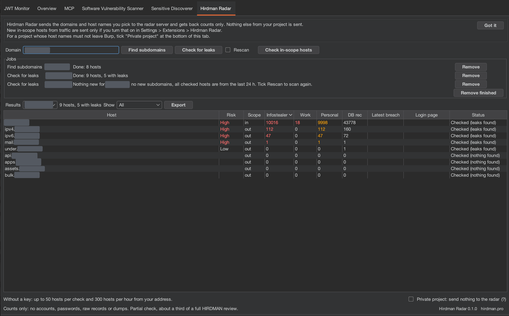
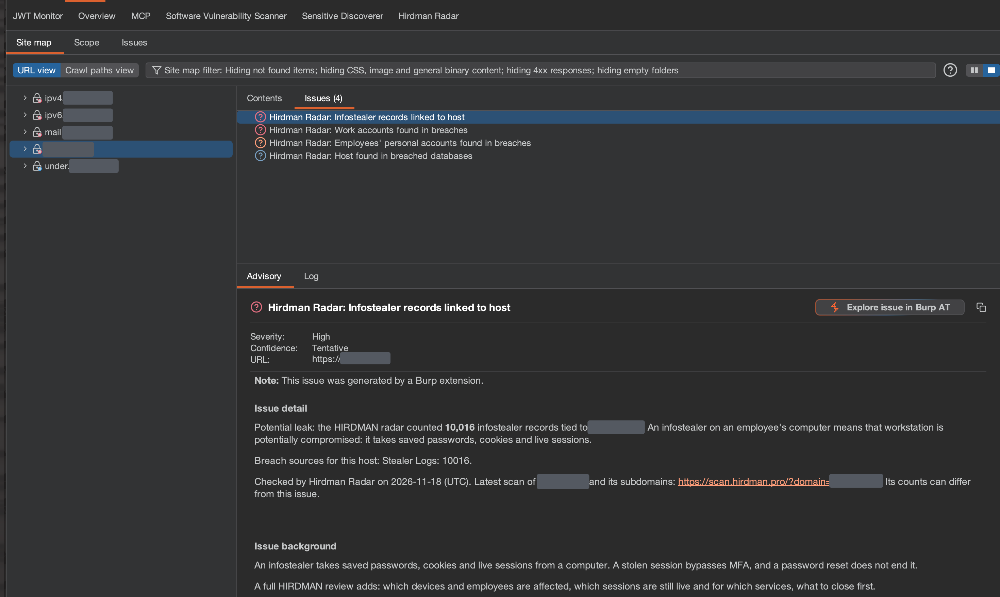

<p align="center">
  
</p>

<h1 align="center">Hirdman Radar for Burp Suite</h1>

<p align="center">
  
  
  
  
  <a href="LICENSE"></a>
</p>

<p align="center"><b>English</b> · <a href="README.ru.md">Русский</a></p>

Hirdman Radar finds the subdomains of a target and shows, for each host, how
many leaked records mention it: infostealer logs, work email addresses and
credentials from breaches, and records in breached databases. The counts and a
risk level appear in Burp, next to the traffic you are already testing.

The plugin is made by the [HIRDMAN](https://hirdman.pro) team. The numbers come
from the leak database behind hirdman.pro. The plugin is free and needs no
account or API key. In Burp's extension list it is called
*Hirdman Radar: Subdomain Leak Check*.

## What it looks like during a test

1. Type a domain on the *Hirdman Radar* tab and click *Check for leaks*, or
   select a request in Proxy and choose
   *Find subdomains and check for leaks* from the context menu.
2. The server finds the subdomains, drops the infrastructure ones and checks
   the most important ones against the leak database.
3. The table fills in as the check runs. Hosts with findings get Burp issues,
   and login pages are marked from the traffic Burp has already seen.

An infostealer log record appears when malware takes the saved logins from an
infected device and one of them is for this host.





The screenshots hide the name of the checked domain.

## Subdomain discovery

The search runs on the HIRDMAN server, and Burp gets the finished list.

1. The server queries four different sources in parallel, Certificate
   Transparency logs among them, then merges the lists and removes duplicates.
2. It drops infrastructure names such as mx, smtp, pop, imap, ns, dns, www,
   proxy, sip and voip.
3. It sorts the remaining subdomains by importance. Mail, remote access and
   sign-in come first (mail, owa, vpn, sso, adfs, citrix), then internal
   systems (admin, gitlab, jira, confluence, crm, jenkins, grafana), then APIs
   and test environments (api, dev, test, staging, uat). Trailing digits and
   hyphenated parts of a name do not change the order: vpn2 counts as vpn, and
   sso-msk as sso.
4. A domain scan checks up to 400 of the most important subdomains. The rest go
   into the table as *Not checked yet*. A line under the table counts them, and
   the *Check them* button sends them as a separate host check.

## What you see for each host

| Column | What it shows |
|---|---|
| *Risk* | The highest level among the host's findings |
| *Scope* | Whether the host is in Burp's target scope |
| *Infostealer* | Infostealer log records that mention the host |
| *Work* | Breach records with work email addresses |
| *Personal* | Breach records with credentials for the host, whoever they belong to |
| *DB rec* | Records in breached databases that mention the host together with an email or URL |
| *Latest breach* | The newest known breach date among the 10 largest sources. Infostealer logs, database records and some sources have no date, so newer breaches are possible |
| *Login page* | A login page seen in Burp's traffic |
| *Status* | The state of the check; the tooltip shows when it last ran |

## What the plugin adds to Burp

| Where | What it does |
|---|---|
| *Hirdman Radar* tab | A field for the domain (a URL works too) and the *Find subdomains* and *Check for leaks* buttons. Jobs run in the background. Filters *With leaks*, *Not checked yet*, *Check failed*, *In scope*. Export to JSON or CSV, and a Markdown summary for your report |
| Context menu | In Target, Proxy, Repeater and Logger: find the subdomains of the selected host's parent domains, or check the selected hosts |
| Issues | Hosts with leaks get issues at `https://<host>/`, one per kind of finding, with *Tentative* confidence, because no analyst has verified the numbers |
| Message editor | Requests to a host from the plugin's table get a read-only *Hirdman Radar* tab with that host's counts |
| *Check in-scope hosts* | Sends the in-scope hosts from the site map for a check, after you confirm |
| Site map | Discovered subdomains appear there as unrequested items (you can turn this off in the settings), and you can add selected rows by hand |
| Login pages | A form with a password field, HTTP authentication and known paths (FortiGate, Cisco, Ivanti and GlobalProtect VPN gateways, Citrix Gateway, plus Outlook on the web, AD FS and Keycloak) are marked from responses Burp has already received. The plugin itself never contacts the hosts |
| Burp project | Results (numbers only) are saved in the project and stay visible after a restart, offline too |

## What leaves Burp

- Only the domain and host names you choose, and only to one server: the
  *Server URL* in *Settings > Extensions > Hirdman Radar*
  (default `https://scan.hirdman.pro`). Requests go through Burp's HTTP stack
  and its upstream proxy settings.
- Requests, responses, cookies and paths from your project stay in Burp. The
  plugin sends no requests to target hosts and never changes the scope on its
  own.
- What comes back is numbers only, with no accounts, passwords, raw records or
  dumps.
- New in-scope hosts from your traffic are checked only if you turn that on in
  the settings. It is off by default.
- If the project's host names must not leave Burp, tick *Private project* at the
  bottom of the Hirdman Radar tab. The plugin then sends nothing for that
  project, and a running job stops before its next request.
- Because the plugin's requests go through Burp's HTTP stack, session handling
  rules whose tool scope includes *Extensions* apply to them, and so do platform
  authentication entries for all hosts. If such rules add credentials, exclude
  the server host from them.
- The plugin keeps answers only about the hosts its job asked about. Answers
  about other hosts are dropped.

## Limits without a key

Up to 50 hosts per check and 300 hosts per hour from your address. A domain can
be rescanned once an hour. A domain scan does not count against the hourly host
limit. The tab shows the server's current limits, and before a large check it
says how long the check will take. A check that hits the hourly limit continues
on its own while Burp is open.

## Install

1. Download `hirdman-radar-<version>.jar` from the
   [releases page](https://github.com/grimnir/hirdman-radar-burp/releases/latest)
   or build it yourself (below). Each release lists the jar's SHA-256.
2. In Burp: *Extensions > Installed > Add*, type *Java*, select the jar.

Requires Burp Suite 2026.7 or later (Montoya API).

## Build

You need JDK 21. Gradle downloads through the wrapper.

```
./gradlew test jar
```

The jar appears in `build/libs/hirdman-radar-<version>.jar`. Tests run headless
against local fakes and never reach the internet.

## Settings

*Settings > Extensions > Hirdman Radar*: Server URL and TLS verification; issues
(create automatically, out-of-scope hosts, lowest severity); site map items for
discovered subdomains; checking hosts from traffic; one re-check of hosts that
could not be checked; the number of retries after network failures;
*Always rescan*.

## About the data

This is a partial check, about a third of a full HIRDMAN check. The plugin shows
how many records were found, and a full check names the specific accounts,
devices and sessions. More about it at [hirdman.pro](https://hirdman.pro).

## License

[PolyForm Shield 1.0.0](LICENSE). You can install, read, build and change the
plugin, including on paid engagements. You can pass copies on together with the
license text and the `Required Notice` line. You cannot use the plugin's code to
make a product that competes with it or with HIRDMAN products built on it. This
is a short summary; the full text in [LICENSE](LICENSE) is what applies.

The jar bundles Gson and Error Prone annotations under the Apache License 2.0,
see [THIRD-PARTY-NOTICES.txt](THIRD-PARTY-NOTICES.txt).
