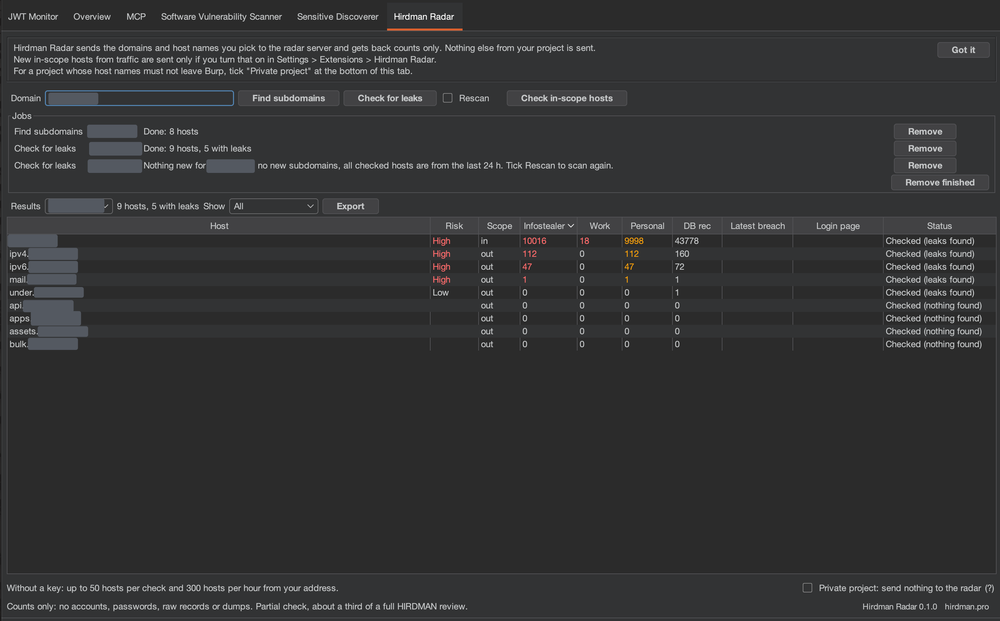
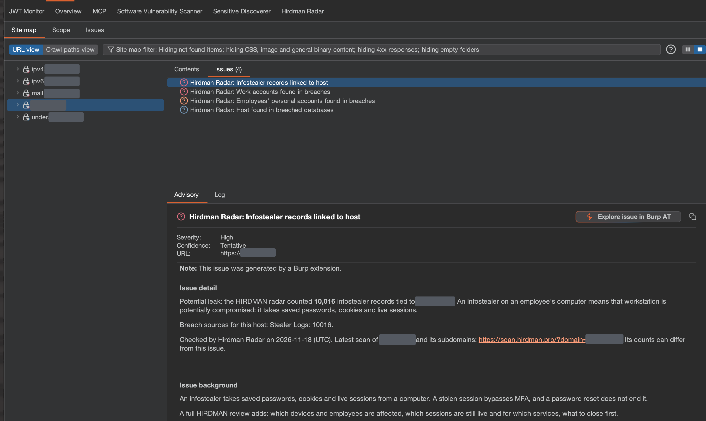

<p align="center">
  
</p>

<h1 align="center">Hirdman Radar для Burp Suite</h1>

<p align="center">
  
  
  
  
  <a href="LICENSE"></a>
</p>

<p align="center"><a href="README.md">English</a> · <b>Русский</b></p>

Hirdman Radar находит поддомены цели и для каждого хоста показывает, сколько
утёкших записей его упоминают: логи стилеров, рабочие адреса почты и учётные
данные из утечек, записи в утёкших базах. Счётчики и уровень риска появляются
в Burp, рядом с трафиком, который вы уже тестируете.

Плагин сделала команда [HIRDMAN](https://hirdman.pro). Числа приходят из базы
утечек, на которой работает hirdman.pro. Плагин бесплатный, регистрация и
API-ключ не нужны. В списке расширений Burp он называется
*Hirdman Radar: Subdomain Leak Check*.

## Как это работает

1. Введите домен на вкладке *Hirdman Radar* и нажмите *Find and check* или
   выделите запрос в Proxy и выберите в контекстном меню
   *Find subdomains and check for leaks*.
2. Сервер находит поддомены, отбрасывает служебные и проверяет самые важные
   по базе утечек.
3. Таблица заполняется по ходу проверки. Хосты с находками получают issues в
   Burp, а страницы входа отмечаются по трафику, который Burp уже видел.





Имя проверенного домена на скриншотах закрыто.

## Поиск поддоменов

Поиск идёт на сервере HIRDMAN, Burp получает готовый список.

1. Сервер опрашивает параллельно четыре источника, среди них журналы
   Certificate Transparency, сливает списки и убирает повторы.
2. Затем отбрасывает служебные имена: mx, smtp, pop, imap, почтовые хосты с
   номером (mail2), ns, dns, www, proxy, sip, voip и похожие, а также хосты
   мониторинга (grafana, zabbix, nagios, prometheus).
3. Остальные поддомены сервер сортирует по важности. Первыми идут почта, удалённый
   доступ и вход в учётные записи (mail, owa, vpn, sso, adfs, citrix), за ними
   внутренние системы (admin, gitlab, jira, confluence, crm, jenkins),
   потом API и тестовые стенды (api, dev, test, staging, uat). Цифры в конце
   и части имени через дефис сортировке не мешают: vpn2 считается как vpn, а
   sso-msk как sso.
4. Скан домена проверяет до 400 самых важных поддоменов. Остальные попадают в
   таблицу как *Not checked yet*. Строка под таблицей считает их, а кнопка
   *Check them* отправляет их отдельной проверкой хостов.

## Что видно по каждому хосту

| Колонка | Что в ней |
|---|---|
| *Risk* | Самый высокий уровень среди находок по хосту |
| *Scope* | Входит ли хост в target scope Burp |
| *Infostealer* | Записи из логов стилеров, в которых упоминается хост: вредоносная программа забрала с заражённого устройства сохранённые входы, cookies или адрес почты на этом хосте |
| *Work* | Записи утечек с рабочими адресами почты |
| *Personal* | Записи утечек с учётными данными для хоста, чьи бы они ни были |
| *DB rec* | Записи в утёкших базах, где хост упоминается вместе с почтой или URL |
| *Latest breach* | Самая свежая известная дата утечки среди 10 крупнейших источников. У логов стилеров, записей баз и части источников даты нет, поэтому более новые утечки возможны |
| *Login page* | Страница входа, замеченная в трафике Burp |
| *Status* | Состояние проверки; время последней проверки в подсказке |

## Что плагин добавляет в Burp

| Где | Что делает |
|---|---|
| Вкладка *Hirdman Radar* | Поле для домена (URL тоже подойдёт), кнопки *Find subdomains* и *Find and check*. Задания идут в фоне. Фильтры *With leaks*, *Not checked yet*, *Check failed*, *In scope*. Экспорт в JSON или CSV, сводка в Markdown для отчёта |
| Контекстное меню | В Target, Proxy, Repeater и Logger: поиск поддоменов родительских доменов выделенного хоста или проверка выделенных хостов |
| Issues | Хосты с утечками получают issues по адресу `https://<host>/`, по одному на вид находки, с уверенностью *Tentative*, потому что числа не проверял аналитик |
| Редактор сообщений | Для хоста из таблицы плагина у запроса появляется вкладка *Hirdman Radar* с его счётчиками, только для чтения |
| *Check in-scope hosts* | Отправляет на проверку хосты из site map, которые входят в scope, после подтверждения |
| Site map | Найденные поддомены из scope попадают туда незапрошенными узлами (выключается в настройках), любые выбранные строки можно добавить вручную |
| Страницы входа | Форма с полем пароля, HTTP-аутентификация и известные пути (VPN-шлюзы FortiGate, Cisco, Ivanti, GlobalProtect, Citrix Gateway, а также Outlook on the web, AD FS, Keycloak) отмечаются по ответам, которые Burp уже получил. Сам плагин к хостам не обращается |
| Проект Burp | Результаты (только числа) хранятся в проекте и видны после перезапуска, в том числе без сети |

## Что уходит из Burp

- Уходят только имена доменов и хостов, которые вы выбрали, и только на один
  сервер: *Server URL* в *Settings > Extensions > Hirdman Radar*
  (по умолчанию `https://scan.hirdman.pro`). Запросы идут через HTTP-стек Burp
  и его настройки upstream-прокси.
- Запросы, ответы, cookies и пути из проекта не уходят. Плагин не шлёт
  запросы на хосты цели и сам не меняет scope.
- Обратно приходят только числа, без учётных записей, паролей, сырых записей
  и дампов.
- Новые хосты из трафика, входящие в scope, проверяются, только если включить
  это в настройках. По умолчанию выключено.
- Если имена хостов проекта не должны покидать Burp, отметьте
  *Private project* внизу вкладки Hirdman Radar. Тогда плагин для этого
  проекта не отправляет ничего, а идущее задание останавливается перед
  следующим запросом.
- Запросы плагина идут через HTTP-стек Burp, поэтому к ним применяются правила
  session handling, в tool scope которых есть *Extensions*, и записи platform
  authentication для всех хостов. Если такие правила добавляют cookies, токены или
  другие учётные данные, плагин останавливает задание и просит исключить хост
  сервера из правил. О прочих добавленных заголовках он пишет в вывод расширения.

Если сервер присылает ответы о хостах, про которые задание не спрашивало,
плагин их не учитывает.

## Что хранит сервер

- Скан домена хранится на сервере 90 дней вместе со временем и адресом, с
  которого он пришёл.
- Кто угодно, кто сканирует тот же домен в течение 30 минут, получает этот
  сохранённый скан вместо нового. Сайт показывает числа и даты прошлых сканов
  домена любому, кто его ищет, но не говорит, кто их запускал.
- Результат проверки хоста хранится 24 часа и общий: проверка того же хоста
  кем угодно в это время получает сохранённый результат и не расходует часовой
  лимит.
- Журнал сервера записывает каждый запрос с адресом клиента.
- Вопросы о хранимых данных: info@hirdman.pro.

## Правила использования

Используйте плагин только для тестирования, на которое у вас есть разрешение.
О злоупотреблениях пишите на info@hirdman.pro.

## Лимиты

Бесплатно до 50 хостов за одну проверку и 300 хостов в час с вашего адреса. Домен можно
пересканировать раз в час. Скан домена не расходует часовой лимит хостов.
Вкладка показывает текущие лимиты сервера, а перед большой проверкой пишет,
сколько она займёт. Проверка, которая упёрлась в часовой лимит, продолжится
сама, пока Burp открыт.

## Установка

1. Скачайте `hirdman-radar-<версия>.jar` со
   [страницы релизов](https://github.com/grimnir/hirdman-radar-burp/releases/latest)
   или соберите его сами (ниже). У каждого релиза указан SHA-256 jar.
2. В Burp: *Extensions > Installed > Add*, тип *Java*, выберите jar.

Нужен Burp Suite 2026.7 или новее (Montoya API).

## Сборка

Gradle запускается на JDK 17 и новее и сам скачивает JDK 21 для сборки.

```
./gradlew test jar
```

Jar появится в `build/libs/hirdman-radar-<версия>.jar`. Тесты идут без окон,
на локальных заглушках, и в интернет не ходят.

## Настройки

*Settings > Extensions > Hirdman Radar*: Server URL и проверка TLS; issues
(создавать автоматически, хосты вне scope, минимальный уровень); узлы site map
для найденных поддоменов; проверка хостов из трафика; подсветка хостов с
утечками в Proxy history (по умолчанию выключена, есть
[фильтр для таких записей](docs/proxy-filter.bambda.md)); одна повторная проверка
хостов, которые не удалось проверить; число попыток, когда сервер недоступен;
*Always rescan*.

## О данных

Это частичная проверка, примерно треть полной проверки HIRDMAN. Плагин
показывает, сколько записей найдено, а полная проверка называет конкретные
учётные записи, устройства и сессии. Подробнее о ней на
[hirdman.pro](https://hirdman.pro).

## Лицензия

[PolyForm Shield 1.0.0](LICENSE). Плагин можно ставить, читать, собирать и
менять, в том числе на платных проектах. Копии можно передавать дальше вместе с
текстом лицензии и строкой `Required Notice`. Нельзя использовать код плагина,
чтобы делать продукт, который конкурирует с ним или с продуктами HIRDMAN,
построенными на нём. Это краткий пересказ, действует полный текст в
[LICENSE](LICENSE). В LICENSE также есть разрешение PortSwigger собирать плагин
и распространять его через BApp Store.

Внутри jar лежит Gson под лицензией Apache 2.0,
подробности в [THIRD-PARTY-NOTICES.txt](THIRD-PARTY-NOTICES.txt).
